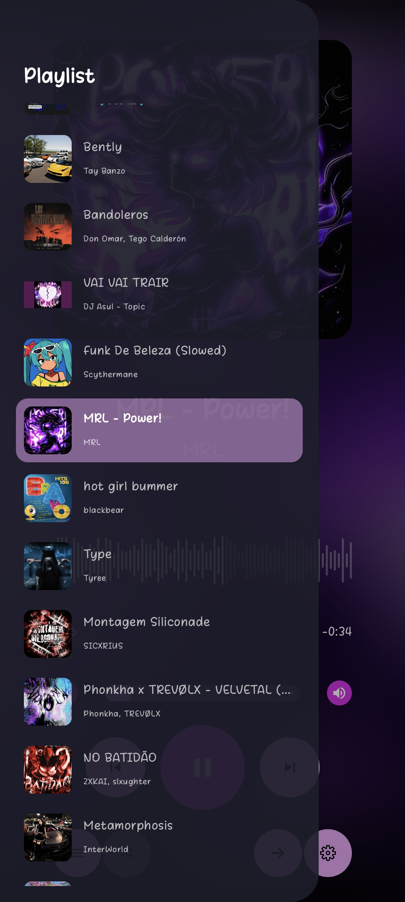
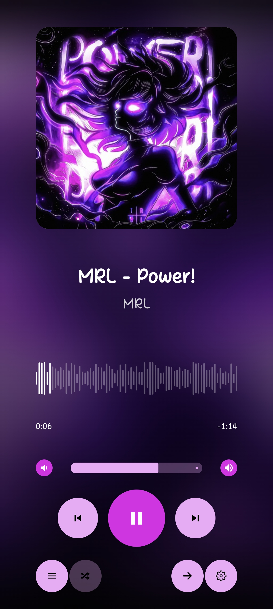

# Amberoid

<p align="center">
  
</p>

**Amberoid** is a super-minimalist music player for Android, inspired by the aesthetics and simplicity of the desktop player Amberol.

It's made for those who just want to listen to music without being distracted by complex settings, volume leveling, or endless playlist creation.

<p align="center">
  
  
</p>

## Features

* **Absolute minimalism:** An interface that doesn't get in the way.
* **Adaptive design:** The interface colors adapt to the cover art of the current track (just like the original).
* **Nothing extra:** Just music, a playlist, and basic controls.
* **Fully open source:** No trackers, analytics, or ads.

## Attribution and Inspiration

This project is an independent implementation of the design ideas of the **Amberol** player for the Android platform.

I express my huge gratitude to **Emmanuele Bassi**, the author of the original Amberol, for creating such a clean and inspiring interface. Amberoid strives to bring this experience to mobile devices while staying true to the spirit of the original.

*Original Amberol:* [https://gitlab.gnome.org/World/amberol](https://gitlab.gnome.org/World/amberol)

## Download

Ready-to-use builds of the app can be found in the **Releases** section:

Latest version:

[](https://github.com/pavlovoiat/amberoid/releases/download/v1.1.0/amberoid.apk)

If you want to download other versions:

1. Go to the [Releases](https://github.com/pavlovoiat/amberoid/releases/) section.
2. Download the **`amberoid.apk`** file (or `app-release.apk`).
3. Install it on your device and enjoy!

## Building from Source

To build, you only need **Git** and **JDK 17** (or newer). Installing Android Studio is not required.

1. Clone the repository:
   ```bash
   git clone https://github.com/pavlovoiat/amberoid.git
   cd amberoid
   ```
2. Build the APK using the Gradle Wrapper:
- **Linux/macOS:**
  ```bash
  ./gradlew assembleRelease
  ```
- **Windows (PowerShell/CMD):**
  ```cmd
  gradlew.bat assembleRelease
  ```
The finished `.apk` will appear at: `app/build/output/apk/release/`.

## Changelog

All updates and the project's changelog are available in the [CHANGELOG.md](CHANGELOG.md) file.

## License

This project is distributed under the **GPL-3.0** license. This means you are free to use, study, modify, and distribute this software, provided that the same license is preserved for derivative works. The full license text can be found in the [LICENSE.md](LICENSE.md) file.
